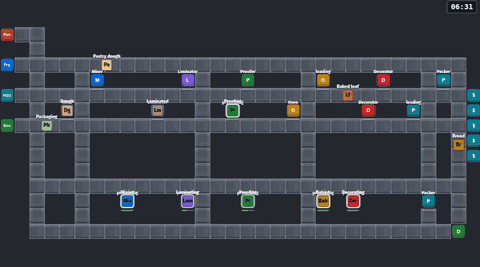
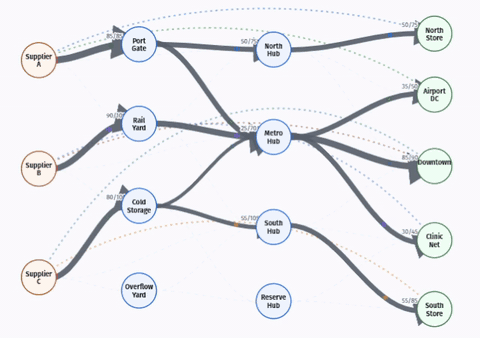
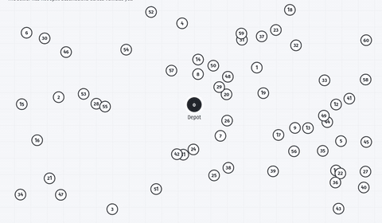
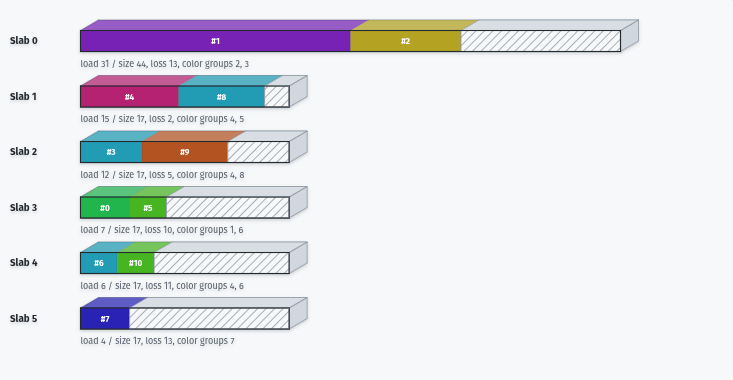

# Google OR-Tools for JavaScript

Build schedules, optimize delivery routes, and solve assignment and packing problems
in TypeScript or JavaScript. Run Google OR-Tools in the browser with multithreaded
WebAssembly, in Node.js, or on a native server through the same API.

[](https://github.com/Axelwickm/or-tools-wasm)
[](https://www.npmjs.com/package/or-tools-wasm)

**Standalone packages:** [](https://www.npmjs.com/package/@or-tools-wasm/cp-sat)
[](https://www.npmjs.com/package/@or-tools-wasm/routing)

[](https://github.com/Axelwickm/or-tools-wasm/actions/workflows/package.yml)
[](https://github.com/Axelwickm/or-tools-wasm/actions/workflows/server.yml)
[](https://github.com/Axelwickm/or-tools-wasm/actions/workflows/package.yml)
[](https://github.com/Axelwickm/or-tools-wasm/actions/workflows/package.yml)
[](https://github.com/Axelwickm/or-tools-wasm/actions/workflows/package.yml)
[](https://github.com/Axelwickm/or-tools-wasm/actions/workflows/package.yml)
[](https://github.com/Axelwickm/or-tools-wasm/actions/workflows/package.yml)
[](https://github.com/Axelwickm/or-tools-wasm/actions/workflows/package.yml)
[](https://github.com/Axelwickm/or-tools-wasm/actions/workflows/package.yml)
[](https://github.com/Axelwickm/or-tools-wasm/actions/workflows/package.yml)
[](https://github.com/Axelwickm/or-tools-wasm/actions/workflows/package.yml)
[](https://github.com/Axelwickm/or-tools-wasm/actions/workflows/package.yml)
[](https://github.com/Axelwickm/or-tools-wasm/actions/workflows/package.yml)
[](https://github.com/Axelwickm/or-tools-wasm/actions/workflows/package.yml)
[](https://github.com/Axelwickm/or-tools-wasm/actions/workflows/package.yml)
[](https://github.com/Axelwickm/or-tools-wasm/actions/workflows/package.yml)

**Install:**

```sh
npm install or-tools-wasm
```

**[Documentation](docs/README.md)** · **[Try the examples](https://axelwickman.com/or-tools-wasm)** · Used in [PragmaPlanner](https://pragmaplanner.com/?utm_source=or-tools-wasm&utm_medium=readme&utm_campaign=used_in).

> [!TIP]
> **Same API. Fast solves on any device.**
>
> [Sign up for the hosted cloud version](https://or-tools-wasm-api.axelwickman.com/info).

- **Scheduling and routing:** build employee rosters, shift schedules, school
  timetables, production plans, and delivery route planners. Solve traveling
  salesman (TSP) and vehicle routing (VRP) problems.
- **Optimization solvers:** Google OR-Tools for constraint programming, linear
  programming (LP), mixed-integer programming (MIP), assignment, bin packing,
  resource allocation, knapsack, and network flow.
- **TypeScript and JavaScript:** build models with typed variables and constraints,
  then read solutions through a consistent API.
- **Browser and server:** run multithreaded WebAssembly in the browser, use Node.js,
  Deno, or Bun, or send the same model to a native server.

### Examples

**Click an image to try it.**

<p>
  <a href="https://axelwickman.com/or-tools-wasm/project_calendar.html"></a>
</p>
<p>
  <a href="https://axelwickman.com/or-tools-wasm/mathopt_factory_floor.html"></a>
  <a href="https://axelwickman.com/or-tools-wasm/sudoku_generator.html"></a>
</p>
<p>
  <a href="https://axelwickman.com/or-tools-wasm/mpsolver_network_design.html"></a>
  <a href="https://axelwickman.com/or-tools-wasm/routing_dispatch.html"></a>
  <a href="https://axelwickman.com/or-tools-wasm/steel_mill_slab.html"></a>
</p>

## Install

```sh
npm install or-tools-wasm
```

Only need one solver? Install [CP-SAT](docs/solvers/cp-sat/README.md) or
[Routing](docs/solvers/routing/README.md) as a smaller standalone package.

```sh
npm install @or-tools-wasm/cp-sat
# Or:
npm install @or-tools-wasm/routing
```

For browser headers, bundler configuration, and jsDelivr imports, see
[Setup](docs/setup.md). Local browser WASM requires cross-origin isolation.

## Solve your first problem

A workshop has 12 hours available. A desk takes 3 hours and earns 20.
A table takes 4 hours and earns 30. What should it make to maximize profit?

```ts
import { CpModel, CpSat } from 'or-tools-wasm/cp-sat';

const model = new CpModel();
const desks = model.newIntVar(0, 4, 'desks');
const tables = model.newIntVar(0, 3, 'tables');

model.addLinearConstraint(desks.times(3).plus(tables.times(4)), 0, 12);
model.maximize(desks.times(20).plus(tables.times(30)));

const result = await CpSat.solve(model, { numWorkers: 1 });

if (result.hasSolution) {
  console.log({
    desks: result.value(desks),
    tables: result.value(tables),
    profit: result.objectiveValue,
  });
}
```

The optimal plan is **3 tables, no desks, and a profit of 90**.

Browser solves use a worker by default to keep the page responsive.
[Execution options](docs/execution.md) cover direct, worker, and server execution,
progress events, and cancellation.

**[Explore the API documentation](docs/README.md)**

## Browser import with jsDelivr

You can import the standalone CP-SAT package without a bundler. Replace `VERSION`
with an exact published version. This example sends the solve to your native server.
Start it from the repository root:

```sh
docker compose -f server/docker-compose.yml up --build
```

Then import and solve:

```html
<script type="module">
  import { CpModel, CpSat } from 'https://cdn.jsdelivr.net/npm/@or-tools-wasm/cp-sat@VERSION/build/javascript/browser/cp-sat.js';

  const model = new CpModel();
  const x = model.newIntVar(0, 10, 'x');
  model.maximize(x);

  const result = await CpSat.solve(model, {
    executor: { type: 'server', url: 'http://localhost:17827' },
  });
  if (result.hasSolution) console.log(result.value(x));
</script>
```

For local WASM execution, use npm and a bundler or serve the package assets from
your own origin so browser workers can load. See [CDN setup](docs/setup.md#import-from-jsdelivr)
and [server setup](server/README.md).

## Supported solvers

| Supported | Solver | What it does |
| --- | --- | --- |
| ✅ | [CP-SAT](docs/solvers/cp-sat/api.md) | Constraint and integer optimization for Boolean, integer, scheduling, and logical models. |
| ✅ | [Routing](docs/solvers/routing/api.md) | Vehicle routing (VRP), TSP, pickup-delivery, time windows, breaks, resource groups, state-dependent transit, and route reoptimization. |
| ✅ | [MPSolver](docs/solvers/mp-solver/api.md) | Linear and mixed-integer programming with selectable backends, incremental sessions, native MIP callbacks, and solution pools where supported. |
| ✅ | [MathOpt](docs/solvers/mathopt/api.md) | Linear, quadratic, and multi-objective models, incremental solving, and native callbacks. Capabilities depend on the selected backend. |
| ✅ | [GLOP](docs/solvers/mp-solver/api.md) | Google's simplex linear programming solver. |
| ✅ | [PDLP](docs/solvers/pdlp/api.md) | First-order LP and convex diagonal quadratic solving, with native model import and iteration statistics. |
| ✅ | [SAT integer programming](docs/solvers/mp-solver/api.md) | CP-SAT-backed integer programming backend for pure integer linear models. |
| ✅ | [CLP](docs/solvers/mp-solver/api.md) | COIN-OR linear programming backend. |
| ✅ | [GLPK](docs/solvers/mp-solver/api.md) | GNU linear and mixed-integer programming backend. |
| ✅ | [SCIP](docs/solvers/mp-solver/api.md) / [GSCIP](docs/solvers/mathopt/api.md) | SCIP-based mixed-integer optimization through MPSolver and MathOpt. |
| ✅ | [CBC](docs/solvers/mp-solver/api.md) | COIN-OR branch-and-cut mixed-integer programming backend. |
| ✅ | [BOP](docs/solvers/mp-solver/api.md) | Boolean/integer optimization backend through MPSolver. |
| ✅ | [Knapsack](docs/solvers/knapsack/api.md) | Dedicated 0-1 and multi-dimensional knapsack solver, plus the MPSolver Knapsack backend. |
| ✅ | [Network flow](docs/solvers/network-flow/api.md) | Dedicated max-flow, min-cost-flow, and linear-sum assignment algorithms. |
| ✅ | [Assignment](docs/solvers/network-flow/api.md) | Linear-sum assignment through the dedicated Network Flow API. |
| ✅ | [Set Cover](docs/solvers/set-cover/api.md) | Weighted set covering with construction and local-search heuristics, MIP and LP methods, and Lagrangian bounds. |
| ✅ | [RCPSP](docs/solvers/rcpsp/api.md) | Resource-constrained scheduling through CP-SAT, including multimode, RCPSP/Max, consumer-producer, and resource-investment models. |

## Compatibility

| Supported | Runtime |
| --- | --- |
| ✅ | Chromium browsers |
| ✅ | Firefox |
| ✅ | Node.js |
| ✅ | Deno |
| ✅ | Bun |
| ✅ | Native C++ solver server |

Local WebAssembly includes JSPI and Asyncify runtimes, with automatic selection
for the current environment. Only the selected runtime is loaded.

**Tested bundlers:** Vite, Webpack, and Rollup.

See [testing](docs/development/testing.md) for the fixture matrix and
[benchmarks](benchmarking/README.md) for performance measurements.

## About

Built on [Google OR-Tools](https://github.com/google/or-tools).
Maintained by [Axel Wickman](https://axelwickman.com).
Licensed under [Apache 2.0](LICENSE).
