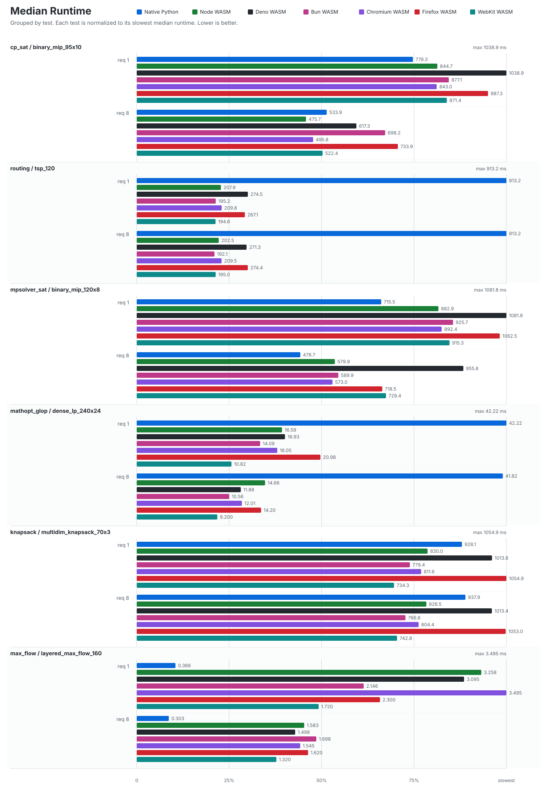

# OR-Tools Benchmarking

The generated results below describe the recorded commit and runtime versions,
not necessarily the current worktree. They are performance measurements, not
a substitute for the fixture and site test suites.

Browser benchmarks include Chromium, Firefox, and Playwright WebKit. WebKit
results use `web-webkit.csv`; they are not measurements of released Safari.

Run the benchmark suite:

```sh
benchmarking/run.sh
```

This packs the local npm package, runs the Docker benchmarks, writes CSVs under `benchmarking/results/`, and refreshes this report. To rerender existing CSVs only:

```sh
python3 benchmarking/scripts/render_results.py
```

To benchmark an already-built release artifact instead of the local build:

```sh
BENCH_PACKAGE_TARBALL=/absolute/path/to/or-tools-wasm.tgz \
BENCH_GIT_SHA=<artifact-source-commit> benchmarking/run.sh
```

<!-- benchmark-report:start -->
## Latest Results

Generated by `python3 benchmarking/scripts/render_results.py` from `benchmarking/results/*.csv`.
Values are medians across recorded runs after the unrecorded warmup solve.

Source CSVs: `native-python.csv`, `wasm-bun.csv`, `wasm-deno.csv`, `wasm-node.csv`, `web-chromium.csv`, `web-firefox.csv`, `web-webkit.csv`. Git SHA: `616889c237-dirty`. OR-Tools versions: Native Python `9.15.6755`; Node WASM `9.15`; Deno WASM `9.15`; Bun WASM `9.15`; Chromium WASM `9.15`; Firefox WASM `9.15`; WebKit WASM `9.15`.



| Suite | Solver | Problem | Requested threads | Native Python ms | Node WASM ms | Deno WASM ms | Bun WASM ms | Chromium WASM ms | Firefox WASM ms | WebKit WASM ms |
| --- | --- | --- | ---: | ---: | ---: | ---: | ---: | ---: | ---: | ---: |
| core | cp_sat | binary_mip_95x10 | 1 | 776.3 | 844.7 | 1038.9 | 877.1 | 843.0 | 987.3 | 871.4 |
| core | cp_sat | binary_mip_95x10 | 8 | 533.9 | 475.7 | 617.3 | 698.2 | 495.8 | 733.9 | 522.4 |
| core | routing | tsp_120 | 1 | 913.2 | 207.9 | 274.5 | 195.2 | 209.8 | 267.1 | 194.6 |
| core | routing | tsp_120 | 8 | 913.2 | 202.5 | 271.3 | 192.1 | 209.5 | 274.4 | 195.0 |
| core | mpsolver_sat | binary_mip_120x8 | 1 | 715.5 | 882.9 | 1081.8 | 925.7 | 892.4 | 1062.5 | 915.3 |
| core | mpsolver_sat | binary_mip_120x8 | 8 | 478.7 | 579.9 | 955.8 | 589.9 | 573.0 | 718.5 | 729.4 |
| core | mathopt_glop | dense_lp_240x24 | 1 | 42.22 | 16.59 | 16.93 | 14.09 | 16.05 | 20.98 | 10.82 |
| core | mathopt_glop | dense_lp_240x24 | 8 | 41.82 | 14.66 | 11.88 | 10.56 | 12.01 | 14.20 | 9.200 |
| core | knapsack | multidim_knapsack_70x3 | 1 | 928.1 | 830.0 | 1013.8 | 779.4 | 811.6 | 1054.9 | 734.3 |
| core | knapsack | multidim_knapsack_70x3 | 8 | 937.9 | 826.5 | 1013.4 | 766.8 | 804.4 | 1053.0 | 742.8 |
| core | max_flow | layered_max_flow_160 | 1 | 0.366 | 3.258 | 3.095 | 2.146 | 3.495 | 2.300 | 1.720 |
| core | max_flow | layered_max_flow_160 | 8 | 0.303 | 1.583 | 1.498 | 1.698 | 1.545 | 1.620 | 1.320 |
<!-- benchmark-report:end -->

Suite definitions live in `suites.json`.
