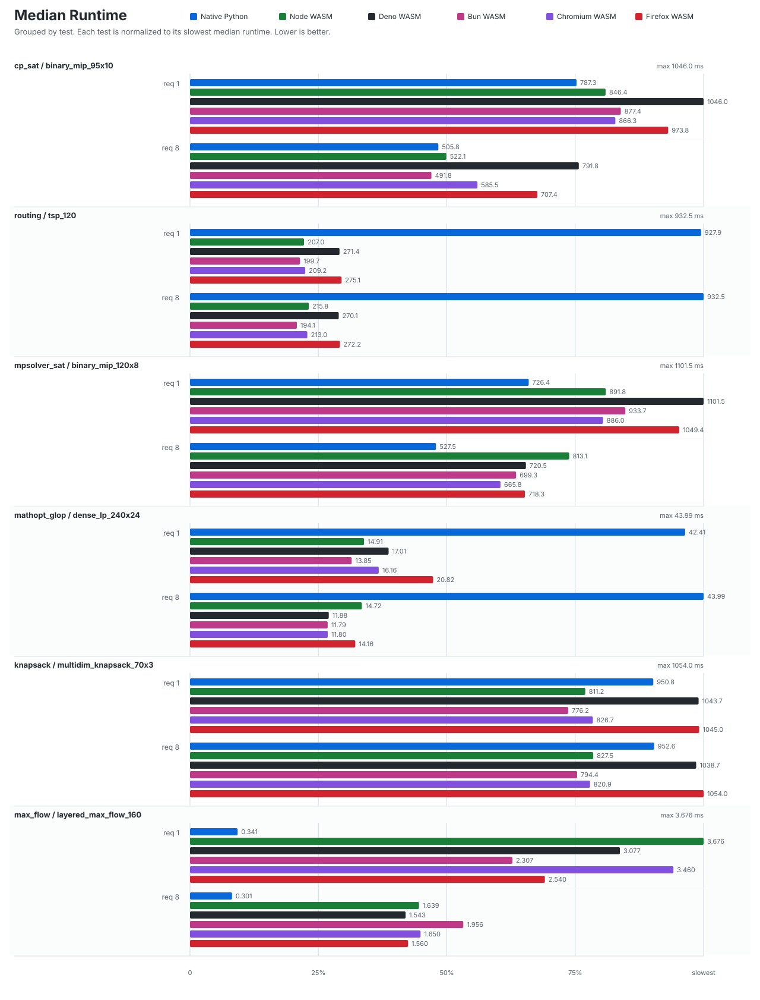

# OR-Tools Benchmarking

The generated results below describe the recorded commit and runtime versions,
not necessarily the current worktree. They are performance measurements, not
a substitute for the fixture and site test suites.

Run the benchmark suite:

```sh
benchmarking/run.sh
```

This packs the local npm package, runs the Docker benchmarks, writes CSVs under `benchmarking/results/`, and refreshes this report. To rerender existing CSVs only:

```sh
python3 benchmarking/scripts/render_results.py
```

To benchmark an already-built release artifact instead of the local build:

```sh
BENCH_PACKAGE_TARBALL=/absolute/path/to/or-tools-wasm.tgz \
BENCH_GIT_SHA=<artifact-source-commit> benchmarking/run.sh
```

<!-- benchmark-report:start -->
## Latest Results

Generated by `python3 benchmarking/scripts/render_results.py` from `benchmarking/results/*.csv`.
Values are medians across recorded runs after the unrecorded warmup solve.

Source CSVs: `native-python.csv`, `wasm-bun.csv`, `wasm-deno.csv`, `wasm-node.csv`, `web-chromium.csv`, `web-firefox.csv`. Git SHA: `d619adf7f01120ddf3b5f66ceaf0e525cf8e3e81`. OR-Tools versions: Native Python `9.15.6755`; Node WASM `9.15`; Deno WASM `9.15`; Bun WASM `9.15`; Chromium WASM `9.15`; Firefox WASM `9.15`.



| Suite | Solver | Problem | Requested threads | Native Python ms | Node WASM ms | Deno WASM ms | Bun WASM ms | Chromium WASM ms | Firefox WASM ms |
| --- | --- | --- | ---: | ---: | ---: | ---: | ---: | ---: | ---: |
| core | cp_sat | binary_mip_95x10 | 1 | 787.3 | 846.4 | 1046.0 | 877.4 | 866.3 | 973.8 |
| core | cp_sat | binary_mip_95x10 | 8 | 505.8 | 522.1 | 791.8 | 491.8 | 585.5 | 707.4 |
| core | routing | tsp_120 | 1 | 927.9 | 207.0 | 271.4 | 199.7 | 209.2 | 275.1 |
| core | routing | tsp_120 | 8 | 932.5 | 215.8 | 270.1 | 194.1 | 213.0 | 272.2 |
| core | mpsolver_sat | binary_mip_120x8 | 1 | 726.4 | 891.8 | 1101.5 | 933.7 | 886.0 | 1049.4 |
| core | mpsolver_sat | binary_mip_120x8 | 8 | 527.5 | 813.1 | 720.5 | 699.3 | 665.8 | 718.3 |
| core | mathopt_glop | dense_lp_240x24 | 1 | 42.41 | 14.91 | 17.01 | 13.85 | 16.16 | 20.82 |
| core | mathopt_glop | dense_lp_240x24 | 8 | 43.99 | 14.72 | 11.88 | 11.79 | 11.80 | 14.16 |
| core | knapsack | multidim_knapsack_70x3 | 1 | 950.8 | 811.2 | 1043.7 | 776.2 | 826.7 | 1045.0 |
| core | knapsack | multidim_knapsack_70x3 | 8 | 952.6 | 827.5 | 1038.7 | 794.4 | 820.9 | 1054.0 |
| core | max_flow | layered_max_flow_160 | 1 | 0.341 | 3.676 | 3.077 | 2.307 | 3.460 | 2.540 |
| core | max_flow | layered_max_flow_160 | 8 | 0.301 | 1.639 | 1.543 | 1.956 | 1.650 | 1.560 |
<!-- benchmark-report:end -->

Suite definitions live in `suites.json`.
