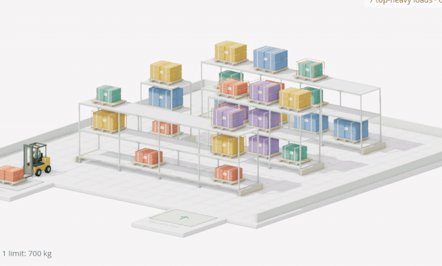

# OR-Tools CP-SAT for JavaScript

[](https://www.npmjs.com/package/cp-sat-wasm)
[](https://www.npmjs.com/package/or-tools-wasm)
[](https://github.com/Axelwickm/or-tools-wasm)

**Install:**

```sh
npm install cp-sat-wasm
```

[**Main repository**](https://github.com/Axelwickm/or-tools-wasm) · [Documentation](https://github.com/Axelwickm/or-tools-wasm/blob/main/docs/README.md) · [Full library on npm](https://www.npmjs.com/package/or-tools-wasm) · [Google OR-Tools](https://github.com/google/or-tools)

> **Same API. Fast solves on any device.**
>
> [Sign up for the hosted cloud version](https://or-tools-wasm-api.axelwickman.com/info).

- **Scheduling and workforce planning:** build employee rosters, shift schedules,
  school timetables, and job-shop schedules with task dependencies and resource limits.
- **Constraint optimization:** solve assignment, bin packing, resource allocation,
  and Sudoku problems. Find feasible plans or optimize costs, staffing, and production.
- **TypeScript and JavaScript:** model problems with typed variables and constraints,
  read independent solution results, and follow progress with callbacks.
- **Browser and server:** run multithreaded WebAssembly locally in browsers, Node.js,
  Deno, or Bun without sending your model data to a server. Use a native server when
  you want remote execution through the same API.

Native Google OR-Tools CP-SAT, directly in JavaScript. No Python service required.
The same API as `or-tools-wasm/cp-sat`, in a smaller standalone package.

### Examples

**Click an image to try it.**

<p>
  <a href="https://axelwickman.com/or-tools-wasm/project_calendar.html"></a>
  <a href="https://axelwickman.com/or-tools-wasm/warehouse_storage.html"></a>
</p>
<p>
  <a href="https://axelwickman.com/or-tools-wasm/sudoku_generator.html"></a>
  <a href="https://axelwickman.com/or-tools-wasm/steel_mill_slab.html"></a>
</p>

## Installation

```sh
npm install cp-sat-wasm
```

The package includes TypeScript declarations and the required runtime. No other
solver package is required.

## Quick start

```ts
import { CpModel, CpSat } from 'cp-sat-wasm';

const model = new CpModel();
const x = model.newIntVar(0, 10, 'x');
model.maximize(x);
const result = await CpSat.solve(model, { executor: 'worker' });
console.log(result.value(x));
```

## Execution

Use `executor: 'direct'` for in-process execution, or
`executor: { type: 'server', url: 'http://localhost:17827' }` for an OR-Tools solver server. Server solves do not load local WASM.

Browser local execution requires cross-origin isolation (COOP/COEP headers).
Worker execution keeps solving off the application's main thread.

The runtime uses **JSPI** when supported and automatically falls back to
**Asyncify** when JSPI is unavailable. Both runtimes are included in the package.
Only the selected runtime is loaded.

When shutting down a Node application after direct execution, call
`terminateLoadedRuntimeThreads()` to release retained runtime threads.

The existing `or-tools-wasm/cp-sat` import remains supported. Choose either distribution; installing both duplicates runtime assets. Model objects should be used with the API that created them.

## Reference and examples

- [CP-SAT API reference](api.md) — model building, solving, results and proto access.
- [Browser setup](https://github.com/Axelwickm/or-tools-wasm/blob/main/docs/setup.md#browser-requirements) and [server configuration](https://github.com/Axelwickm/or-tools-wasm/blob/main/server/README.md).
- [Calendar scheduling](https://axelwickman.com/or-tools-wasm/project_calendar.html), [Steel Mill Slab](https://axelwickman.com/or-tools-wasm/steel_mill_slab.html) and [Model Playground](https://axelwickman.com/or-tools-wasm/model_playground.html).
